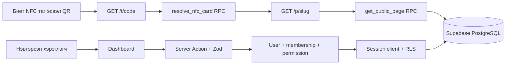

# Архитектур

## Интерфэйс ба хэлний бүтэц

Монгол хэл default. `src/lib/messages/mn.ts` нь маркетинг, auth, public болон validation бичвэрийг feature namespace-аар хадгална; `*-copy.ts` файлууд нь menu/organization/NFC/admin зэрэг domain dictionary юм. `src/lib/messages/index.ts` дахь `getMessages(locale)` нь type-checked English override болон Монгол fallback-тай. Шинэ user-facing бичвэрийг JSX-д шууд нэмэхгүй. English нь бэлтгэсэн архитектур бөгөөд бүрэн орчуулгатай language switcher гэж үзэхгүй.

DashboardShell нь server-rendered хүүхдүүдийг slot байдлаар авдаг жижиг client component; authorization/data fetch сервер дээр хэвээр. Native dialog нь focus trap/Escape, confirmation нь default cancel үйлдэлтэй. Menu/cards/admin users жагсаалтууд stable ordering ба database count/range ашиглан хуудаслагдана.

NFC Smart нь Next.js App Router + React + TypeScript frontend/server, Supabase Auth/PostgreSQL/Storage backend-тай. Нэг database-д олон байгууллага хадгалагдана; server authorization болон RLS аль аль нь байгууллагын хязгаарыг шалгана.

## Хүсэлтийн урсгал

`/t/[code]` нь immutable картын кодыг тухайн мөчийн destination page-тэй холбодог. Кодыг тагт нэг удаа бичнэ. Очих хуудас зөвхөн тухайн байгууллагын идэвхтэй, нийтлэгдсэн internal page байна. Public page болон redirect-д байнгын cache ашиглахгүй; мэдээллийн өөрчлөлт дараагийн хүсэлтэд харагдана.

## Source бүтэц

| Байршил | Үүрэг |
| --- | --- |
| `src/app/(marketing)` | Нүүр, боломжууд, үнэ, contact |
| `src/app/(auth)` | Бүртгэл, нэвтрэлт, нууц үг сэргээх |
| `src/app/auth/callback` | Supabase code exchange, зөвшөөрөгдсөн local redirect |
| `src/app/dashboard` | Protected байгууллага, меню, хуудас, карт, analytics, тохиргоо |
| `src/app/p/[slug]` | Dynamic нийтэлсэн public page renderer |
| `src/app/t/[code]` | NFC/QR тогтмол холбоосын redirect |
| `src/app/api/assets/[...path]` | Private asset read gate болон binary response |
| `src/app/api/contact-card/[slug]` | Нийтэлсэн бизнес картын vCard |
| `src/lib/auth.ts` | Authenticated user, organization permission, platform admin шалгалт |
| `src/lib/actions` | Zod validation болон server mutations |
| `src/lib/supabase` | Browser, SSR session, server-only service client |
| `src/lib/storage.ts` | Asset path URL, upload хэмжээ/type/signature шалгалт |
| `src/components/marketing` | Marketing, public menu, public data helpers, scoped CSS |
| `supabase/migrations` | Schema, constraints, RLS, grants, triggers, RPC, bucket |
| `scripts/test-database.mjs` | Production migration дээр ажиллах isolated PostgreSQL тест |

## Authentication ба authorization

Supabase SSR cookies-г Next.js proxy шинэчилнэ. `requireUser` сервер дээр `auth.getUser()` ашиглаж шалгана. `requireOrg` нь сонгосон байгууллага болон `organization_members` мөрийг бодитоор уншаад role/permission шалгана. `active_org` cookie эсвэл form-ийн organization UUID өөрөө эрхийн нотолгоо болохгүй.

Owner бүх байгууллагын resource удирдана. Staff-д menu/pages/cards/analytics эрхийг тус тус өгнө. Role/member өөрчлөлтийг хамгаалагдсан database function-оор гүйцэтгэж, сүүлийн owner-ийг хасахыг хориглоно. Platform admin нь `private.platform_admins` дахь trusted grant-аар тодорхойлогдоно; user metadata-д тулгуурлахгүй.

Server Action form validation хийсний дараа session client-аар SQL хүсэлт илгээнэ. Database RLS, composite foreign keys, immutable ID/code trigger нь server кодын гаднаас хийх API хүсэлтэд ч дүрмийг баримтална.

## Public data

Anonymous хэрэглэгч private application table-г шууд уншихгүй. `get_public_page` нь идэвхтэй байгууллагын нийтэлсэн page-г whitelist талбараар буцаана. Menu page-д зөвхөн active category болон published item орно; `is_available=false` бүтээгдэхүүн “Түр дууссан” гэж харагдана. Menu бус page-д менюгийн dataset буцаахгүй.

`src/components/marketing/public-data.ts` серверийн helper publication-filtered RPC ашигладаг. React `cache()` нь зөвхөн нэг rendering request дотор metadata/page давхардсан уншилтыг нэгтгэнэ. Next.js route `force-dynamic`, `revalidate=0` тул хүсэлт хооронд stale menu хадгалахгүй.

Public menu-ийн нэр/тайлбар нь React text болж дүрслэгдэнэ. External холбоос зөвхөн HTTP/HTTPS, credentials-гүй URL байна. Branding CSS зөвхөн `#RRGGBB`; CTA text color-ийг luminance-аар сонгоно. vCard нь business-card төрлийн нийтэлсэн хуудсаас үүсэж, control character escaping, CRLF, UTF-8 byte-aware line folding ашиглана.

## Зураг

Зургийг private `organization-assets` bucket-д `<org>/<scope>/<random UUID>.<extension>` нэрээр байрлуулна. Original file name хэрэглэгчийн өгөгдөлтэй хамт URL-д орохгүй. JPEG/PNG/WebP magic bytes болон 5 MiB хязгаар шалгана.

Public зураг `/api/assets/...` руу орж, `get_public_asset` нийтэд харагдах content-д үнэхээр ашиглагдсан эсэхийг баталгаажуулсны дараа server credential-аар уншина. Нэвтэрсэн editor зураг үзэхдээ өөрийн session-ийн Storage RLS-ээр эрхээ баталгаажуулна. Unpublished эсвэл inactive resource-ийн зураг anonymous-д нээгдэхгүй.

## Analytics-ийн утга

Хандалт бол картын холбоосоор нээгдсэн хуудасны event. QR download link `src=qr` attribution авч болно; бусад эх үүсвэр `unknown`. HTTP хүсэлтээр бодит NFC hardware tap эсэхийг нотлох боломжгүй тул “NFC tap” эсвэл “unique visitor” гэж хэмжээг илэрхийлэхгүй.

Raw IP/UA scan table-д хадгалахгүй. Server өдөр солигддог оролттой HMAC fingerprint үүсгэж богино хугацааны database rate limit-д хэрэглэнэ. Vercel-ийн итгэмжлэгдсэн forwarding header байхгүй hosting дээр event бүртгэхийг алгасдаг. Энэ нь өөр hosting-д analytics ажилласан мэт харагдуулахаас зайлсхийх intentional хязгаарлалт; өөр hosting-ийн trusted ingress-ийг тусад нь хэрэгжүүлж шалгах шаардлагатай.

Analytics алдаа redirect-ийг хаахгүй. SQL access model болон илүү дэлгэрэнгүй invariant-ийг [database.md](database.md), production security тохиргоог [security.md](security.md) үзнэ.
